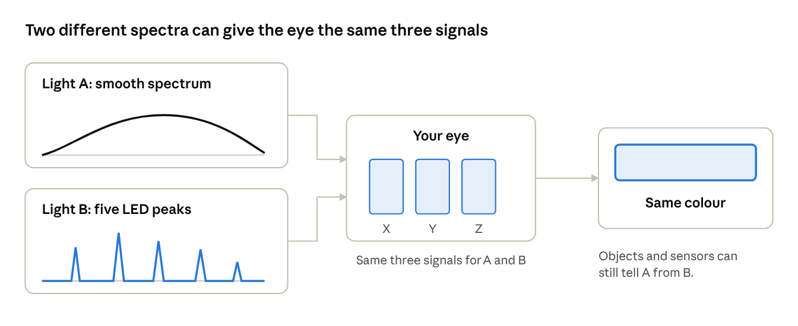

# Executive summary

*Oct 9, 2026*

This project builds a controller for LED strip lights that keeps the colour of white light the same from fixture to fixture, as the lights warm up, and over years of use.

## The goal

LED lights drift. Two strips from the same box can differ slightly in colour, a strip changes colour as it heats up, and it shifts again over years. Ketra answers this by pairing an accurate calibration table with sensors built into each fixture.

This build copies that approach at strip level: a QuinLED An-Penta-Plus controller with five dimming channels, a five-channel LED strip (RGB plus two whites), a spectral sensor and a temperature sensor in each fixture, and Home Assistant for control. The target is fixtures that match each other within 2–3 MacAdam steps. One step is roughly the smallest colour difference an observer can notice. Ketra claims 1 step; a plain constant-voltage strip driver cannot reach that.

## The key idea: metamerism

Think of your eye as three buckets left out in the rain. Very different rainfall can fill all three buckets to the same level, and from the buckets alone you cannot tell which rain it was. Light works the same way. The eye reduces any light, whatever wavelengths it contains, to three signals. Two lights that give the same three signals look the same colour even when their spectra differ. This is called metamerism.

*Metamerism sketch · two spectra, one colour*

It matters in two ways:

- **It makes the build possible.** Five LED channels can be mixed to imitate a white, and many different mixes give the same colour.
- **It is also the trap.** Two lights that match to the eye can still make coloured objects look different, and a sensor with too few bands cannot tell the mixes apart. The build answers this with high-CRI white LEDs and a many-band spectral sensor.

[Open the interactive metamerism demo](https://claude.ai/artifact/NkPrzZC7hK8L7FC9SoEG83) to rotate a 3D light box, switch the light, and watch two matching things separate. It is a separate page because a doc cannot run interactive 3D; the sketch above is the static version.

## How the build keeps colour steady

1. **Calibrate once.** Each fixture is measured with a colour meter to build a table of what its five channels really produce.
2. **Solve.** Home Assistant sends a target colour and brightness. The controller uses the table to pick the five channel levels.
3. **Watch the heat.** A temperature sensor on the aluminium channel lets the controller compensate as the strip warms.
4. **Trim by light.** A spectral sensor inside the fixture checks what the strip is actually producing and slowly nudges each channel, limited to ±10%. When the room is empty, the controller briefly blanks the LEDs to measure and subtract stray room light.

The whole loop runs on the controller, so the lights keep working if Home Assistant or the network goes down. Details are in [System design](system-design.md).

## Where things stand

Two decisions are made: the QuinLED An-Penta-Plus as the controller, and a Ketra A20 as the colour reference. Everything else is a proposal from research. Two questions are still open: which instrument builds the calibration table (a used i1Pro 2 with ArgyllCMS, or a Sekonic C-800 or UPRtek MK350D), and whether the A20 or absolute CIE values act as the reference standard. See [Decision log](decision-log.md) and [Open questions and risks](open-questions-and-risks.md).
