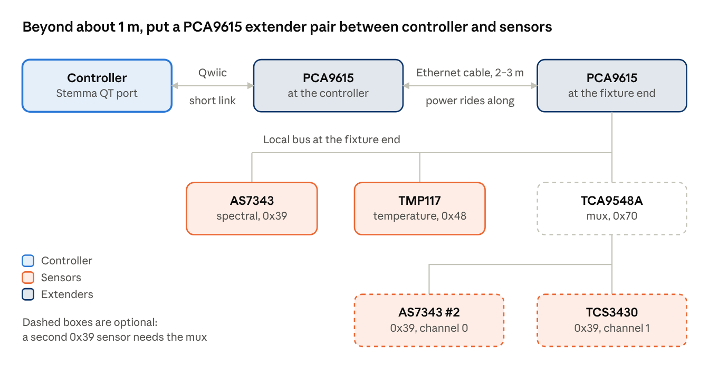

# Optical feedback

An AS7343 inside each fixture splits one mixed reading into each channel's actual output, and slow gain corrections fix drift. This replaces Ketra's approach of lighting one LED at a time, which a strip driver can't do invisibly.

## Design

- **Placement:** in the channel end cap, facing the inside of the diffuser, with black foam baffles so room light barely reaches it.
- **Unmixing:** each channel has a fixed fingerprint across the sensor's bands, recorded during calibration. Solve the mixed reading for each channel's contribution with non-negative least squares.
- **Correction:** compare each channel's measured contribution to the expected one. Low-pass the ratio over minutes and limit it to ±10%. This fixes drift, not fast changes.
- **Ambient check:** when Home Assistant reports the room empty, blank all channels for one reading (about 3–10 ms) to measure and subtract room light.
- **Flicker aliasing:** set sensor integration to a whole number of PWM periods, at least 50, and leave margin for the sensor's ±5% clock.
- **Weak spot:** the two white channels have similar fingerprints. If the solve is unstable, correct overall colour only and leave the warm/cool split open-loop.
- **Driver:** ESPHome's sensor support for the AS7343 is in flux, so bundle a driver inside the external component.

## Cable length and extenders

The sensor sits in the far end cap of a 2–3 m fixture, so the run from the controller will usually be past the 1 m limit in the open items below. A pair of SparkFun PCA9615 boards turns SDA and SCL into differential signals, sends them down an Ethernet cable, and turns them back into standard I²C at the fixture end. The local bus at the fixture end is the same chain as in [System design](../system-design.md). Proposed, not yet bought.

*I²C long-run variant · PCA9615 pair and optional TCA9548A*

### PCA9615 extender (SparkFun Qwiic breakout)

| Item | Detail |
| --- | --- |
| Differential pairs | RJ-45 pins 1 and 2 are DSCL- and DSCL+; pins 7 and 8 are DSDA- and DSDA+. Each must be a twisted pair, which standard Ethernet cable already provides. |
| Connectors | Qwiic on the I²C side, RJ-45 on the differential side |
| Supply | VDDA (I²C side) 2.3 to 5.5 V; VDDB (differential side) 3.0 to 5.5 V. The VDD A-B jumper is closed by default, so one 3V3 supply feeds both |
| Remote power | With the VDDB and GND jumpers left closed, the cable also powers the far board and a few sensors. For many sensors, cut those jumpers and power each end separately |
| Pull-ups | Each board has a pull-up jumper. With several boards on one bus, leave only one pair of pull-ups enabled |

### TCA9548A multiplexer (only for a second 0x39 sensor)

| Item | Detail |
| --- | --- |
| Address | 0x70 by default, adjustable up to 0x77 with A0 to A2 |
| Channels | Eight, each its own SDA/SCL pair; select one by writing a single byte to the mux |
| Speed and supply | Up to 400 kHz; 1.65 to 5.5 V |
| Pull-ups | Each downstream channel needs external pull-ups; check whether the breakout provides them |
| Reset | Dedicated reset pin; power-up leaves all channels deselected |

Not yet checked: how far a PCA9615 pair runs reliably at the I²C speed this build will use. Neither SparkFun's guide nor TI's mux page states a distance, so test the real cable before committing.

Sources: [SparkFun PCA9615 hookup guide](https://learn.sparkfun.com/tutorials/qwiic-differential-i2c-bus-extender-pca9615-hookup-guide/hardware-overview), [TI TCA9548A](https://www.ti.com/product/TCA9548A).

## Done when

After deliberately dimming one channel by 5% in firmware, the loop restores the colour within Δu′v′ 0.002.

## Open items

- [ ] Design the printed end cap and baffle.
- [ ] Decide whether to add a TCS3430 as a cross-check (needs an I²C multiplexer).
- [ ] Check cable length from controller to sensor; beyond about 1 m, add an I²C extender.
