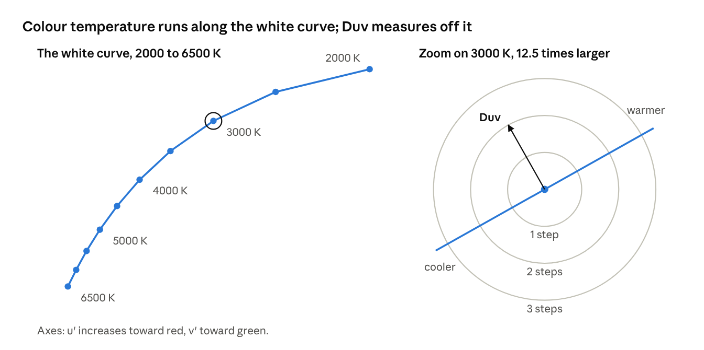
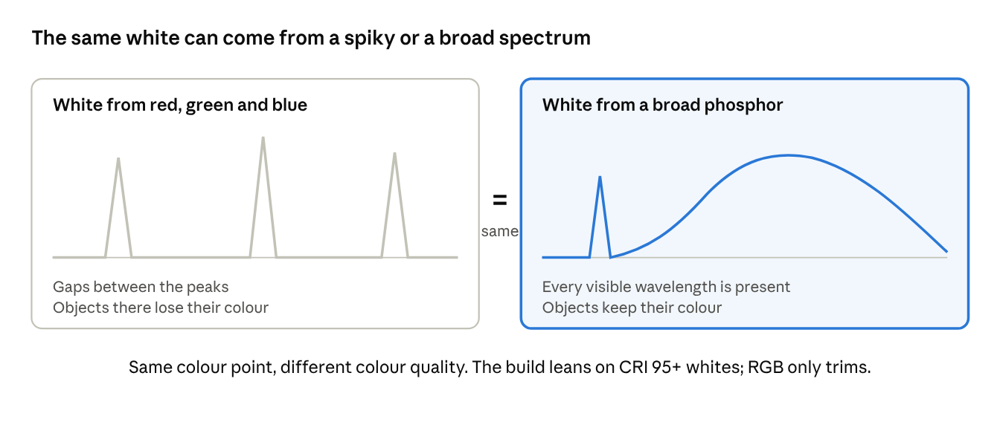
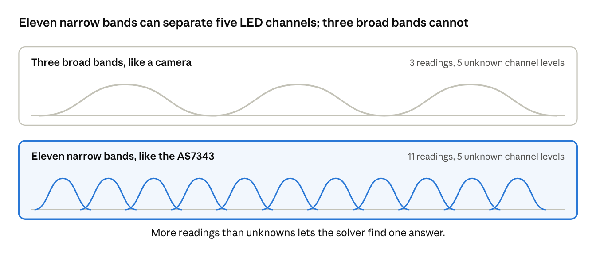
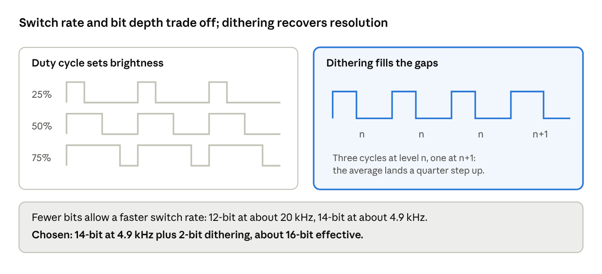
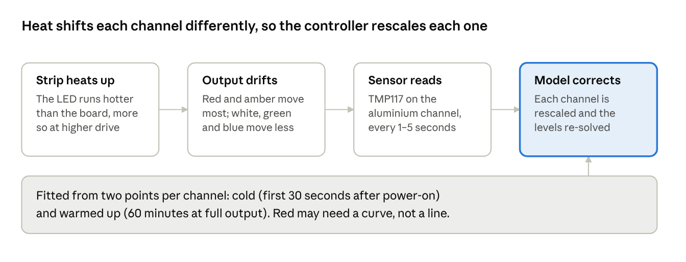
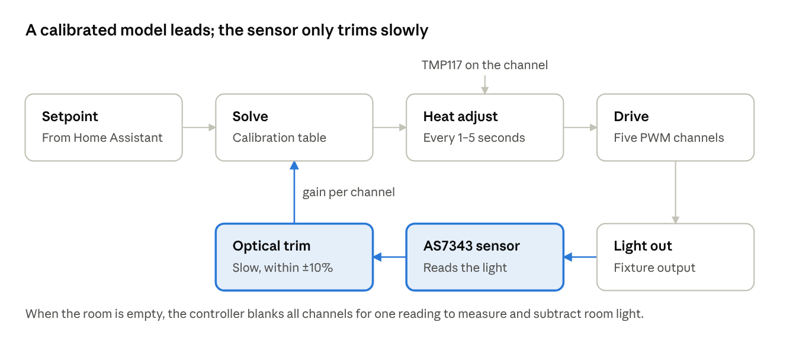

# Principles

*Oct 9, 2026*

Six ideas explain most of this design: how a white is located, why the spectrum still matters, why the sensor needs many bands, how dimming works, how heat shifts colour, and why a model leads while the sensor only trims.

## Where a white sits

Any white light is a point on a colour chart. Colour temperature (CCT, in kelvin) is how far along the white curve it sits, and Duv is how far it sits above or below the curve: above is greener, below is pinker. This build covers about 2000–6500 K with a Duv offset.

*Computed · blackbody curve, 2000–6500 K, approximate CIE 1931 observer*

The right panel zooms in 12.5 times to show the scale of a MacAdam step: one step is about 0.001 in Δu′v′. Ketra claims 1 step, and this build aims for 2–3.

## Spectrum shape sets colour quality

Two whites can sit at the same point on the chart and still render the world differently. A white made from narrow red, green and blue peaks leaves gaps, so an object that reflects only those gaps looks dull or shifted. A broad phosphor white covers the whole visible range.

*Schematic · spectrum shapes, not measured*

This is why the strip choice favours CRI 95+ whites to do the fidelity work, with red, green and blue only trimming the colour point.

## Why the sensor needs many bands

A three-band sensor gives three numbers, but the strip has five channels, so many different channel mixes produce the same three readings. The AS7343 reports 11 visible bands, enough to separate the five channels from one reading. Each channel has a fixed fingerprint across the bands, recorded during calibration, and non-negative least squares finds how much of each fingerprint the reading contains.

*Schematic · sensor bands, not measured responses*

The weak spot is the two white channels, whose fingerprints are similar. If that solve is unstable, the controller corrects overall colour only and leaves the warm and cool split open-loop.

## Dimming by PWM

The controller dims each channel by switching it on and off faster than the eye can follow. The share of each cycle spent on, the duty cycle, sets the brightness. The counter has a fixed number of steps, so more bits means a slower switch rate.

*Schematic · waveforms are illustrative*

This build runs at about 4.9 kHz with 14-bit steps and adds 2-bit temporal dithering. The output alternates between neighbouring levels so the average lands between them, which gives about 16-bit effective resolution for smooth dimming at warm, low levels.

## Heat changes colour

A strip warms up after power-on, and LEDs of different colours respond differently: the patents flag red and amber as the most temperature-sensitive. The colour at a fixed setting therefore drifts as the strip heats.

*From the [Temperature compensation](features/temperature-compensation.md) design*

White, green and blue are modelled as linear in temperature, and red likely needs a curve. Self-heating is modelled as board temperature plus a per-channel factor times that channel's drive level. See [Temperature compensation](features/temperature-compensation.md) for the design.

## Model first, sensor trims

The controller works feed-forward. An accurate calibration table picks the channel levels, and the temperature reading rescales them, so most of the colour is right before any sensor looks at the light. This mirrors Ketra's structure: an accurate calibration table first, infrequent optical correction second.

*From the [System design](system-design.md) control loop*

The optical path is slow and bounded on purpose. It low-passes each channel's ratio over minutes and limits it to ±10%, so it fixes drift rather than fast changes. See [Optical feedback](features/optical-feedback.md) for the sensor design.
