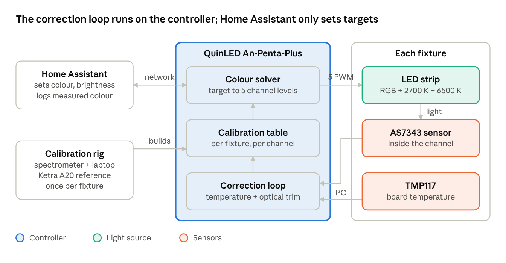
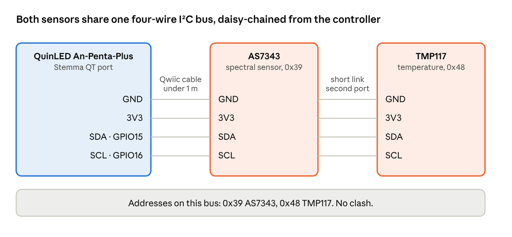
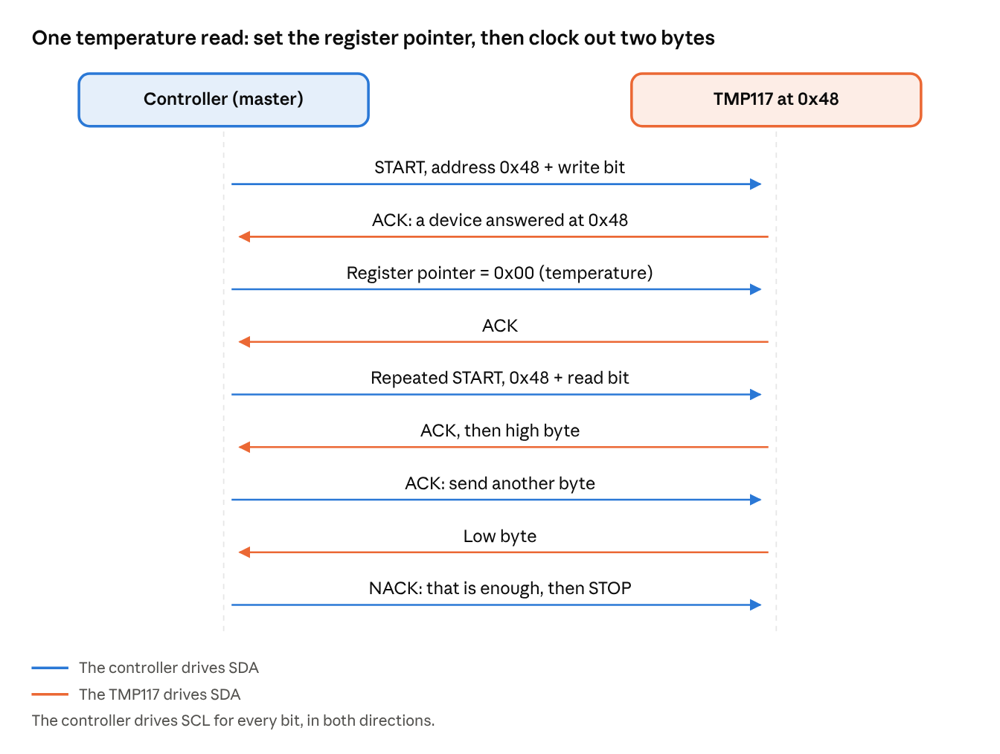

# System design

*Oct 9, 2026*

The build aims for commercial-grade colour consistency at strip level: fixtures that hold a target colour within about 2–3 MacAdam steps of each other, across temperature and over years. Ketra itself claims 1 step; a constant-voltage PWM strip driver can't reach that.

## Goal and targets

| Target | Value | Status |
| --- | --- | --- |
| Fixture-to-fixture match | Within 2–3 MacAdam steps (Δu′v′ about 0.002–0.003) | Proposed |
| Drift from cold start to warmed up | Δu′v′ under 0.002 | Proposed |
| White range | About 2000–6500 K, with a Duv offset | Proposed |
| Reference standard | Match a Ketra A20, or absolute CIE values | Open |
| Scale | Number of fixtures and rooms | Open |

## Architecture

*System architecture · controller, fixture, Home Assistant, calibration rig*

The controller runs the whole correction loop locally, so the lights keep working if Home Assistant or the network goes down. The calibration rig is used once per fixture to build its table.

## Components

Only the controller and the A20 are decided so far; everything else is a proposal from the research. The [Decision log](decision-log.md) tracks changes.

| Component | Role | Choice | Status |
| --- | --- | --- | --- |
| Controller | Drives 5 PWM channels, runs the colour solver and correction loop | QuinLED An-Penta-Plus (ESP32) | Decided |
| Firmware | Solver, temperature model and sensor loop on the device | ESPHome with a custom C++ external component (not WLED) | Proposed |
| LED strip | Light source; RGB plus two whites | Yuji CRI-MAX 5-in-1 RGBWW, 24 V, 60 LEDs/m | Proposed |
| Optical sensor | Measures each channel's contribution inside the fixture | ams AS7343 14-channel spectral sensor | Proposed |
| Temperature sensor | Board temperature for drift correction | TI TMP117 on the aluminium channel | Proposed |
| Fixture body | Holds strip, diffuser and sensors; blocks room light from the sensor | Deep aluminium channel, opal diffuser, printed sensor end cap | Proposed |
| Power | 24 V supply | UL-listed Class 2 LED supply, ≥125% of load | Proposed |
| Network | Setpoints in, data out | WiFi; Ethernet where a cable is easy | Proposed |
| Reference lamp | Colour target and meter check | Ketra A20 | Decided (control method open) |
| Calibration instrument | Builds each fixture's calibration table | Used i1Pro 2 + ArgyllCMS, or Sekonic C-800 / UPRtek MK350D | Open |

## I²C bus and wiring

Both sensors share one four-wire I²C bus on the controller's Stemma QT port, which is a single JST-SH 1.0 mm connector: GPIO15 is SDA and GPIO16 is SCL. The AS7343 and TMP117 breakouts each have two Qwiic connectors wired straight through, so the sensors daisy-chain with short cables and no extra parts. Keep the cable from the controller to the first sensor under about 1 m; beyond that, see [Cable length and extenders](features/optical-feedback.md#cable-length-and-extenders) in Optical feedback. All of this is Proposed until the parts are bought.

*I²C wiring · controller to AS7343 to TMP117*

| Signal | Controller (An-Penta-Plus) | AS7343 | TMP117 | Qwiic wire |
| --- | --- | --- | --- | --- |
| GND | Stemma QT GND | GND | GND | Black |
| 3V3 | Stemma QT 3V3 | 3V3 | 3V3 | Red |
| SDA | GPIO15 | SDA | SDA | Blue |
| SCL | GPIO16 | SCL | SCL | Yellow |

### Addresses on the bus

| Device | Address | How it is set | Checked |
| --- | --- | --- | --- |
| AS7343 | 0x39 | Fixed | From the design notes, not re-checked |
| TCS3430 (optional) | 0x39 | Fixed | From the design notes, not re-checked |
| TMP117 | 0x48 (default), 0x49, 0x4A, 0x4B | ADD0 pin to GND, V+, SDA or SCL. On a breakout this is a solder jumper where the board has one (confirmed for SparkFun's board; Adafruit #4821 pads not checked) | Confirmed: ESPHome docs, Linux kernel binding, TI datasheet (four addresses from ADD0) |
| TCA9548A | 0x70 (default) to 0x77 | Three address pins, up to eight muxes per bus | Confirmed: TI product page (three address pins, eight devices); 0x70 to 0x77 range from Adafruit's product page |

The AS7343 and TCS3430 both sit at 0x39, so a fixture with both needs the TCA9548A (see [Optical feedback](features/optical-feedback.md)). The base build, one AS7343 plus one TMP117, has no clash.

### What one read looks like

SDA and SCL are open-drain: a device only ever pulls a line low and the pull-ups return it high, which is why several devices can share two wires. Every byte is followed by an ACK or NACK bit. The firmware reads the TMP117 as a pointer write to register 0x00 followed by a two-byte read; the AS7343 follows the same pattern with its own registers.

*I²C read of the TMP117 temperature register · 9 steps*

Sources: [QuinLED An-Penta-Plus pinout guide](https://quinled.info/quinled-an-penta-plus-pinout-guide/), [QuinLED An-Penta-Plus board terminals](https://quinled.info/quinled-an-penta-plus-board-terminals/), [ESPHome TMP117](https://esphome.io/components/sensor/tmp117), [TI TCA9548A](https://www.ti.com/product/TCA9548A), [TI TMP117 datasheet](https://ti.com/document-viewer/lit/SNOSD82D/GUID-15DF8DE7-E1E0-4EF8-8937-A40EA4F097CF).

## Control loop

The model does most of the work; the sensor only trims slow drift. This mirrors Ketra's structure: an accurate calibration table first, infrequent optical correction second.

1. **Setpoint.** Home Assistant sends a colour temperature (or x, y and Duv) plus brightness.
2. **Solve.** The controller converts the target to five channel levels using the fixture's calibration table. A precomputed lookup along the white curve keeps this fast.
3. **Temperature adjust.** Every 1–5 seconds the TMP117 reading rescales each channel's expected output, and the levels are re-solved.
4. **Optical trim.** Every 1–10 seconds the AS7343 reading is split into each channel's actual contribution. Each channel gets a slow gain correction, limited to ±10%.
5. **Ambient check.** When the room is empty, the controller blanks all channels for a few milliseconds to measure leaked room light and subtract it.
6. **Report.** Measured colour, temperature and per-channel corrections go back to Home Assistant for logging.

## Constraints and non-goals

**Constraints and how they're handled**

- **No forward-voltage sensing or LED-as-sensor.** The An-Penta switches a constant-voltage strip, so Ketra's per-die sensing is out. Handled by the TMP117 plus a self-heating model, with optional INA226 current monitors per channel as the closest stand-in. The AS7343 replaces LED-as-sensor and gives richer data.
- **PWM resolution vs frequency.** About 12-bit at 20 kHz, 14-bit at 4.9 kHz. Handled by running at about 4.9 kHz, adding 2-bit temporal dithering for about 16-bit effective, and calibrating the lowest duty levels directly.
- **Shared I²C address 0x39.** No conflict with one spectral sensor per controller. A second 0x39 sensor on the same controller goes through a TCA9548A multiplexer, which ESPHome supports natively.
- **Personal build, not for sale.** Ketra's patents only matter if this ever becomes a product.

**Non-goals**

- One-step MacAdam matching.
- Per-LED (pixel) addressing. Long runs use separately driven zones instead.
- Invisible measurement blanking at full brightness. Blanking runs only when the room is empty.
